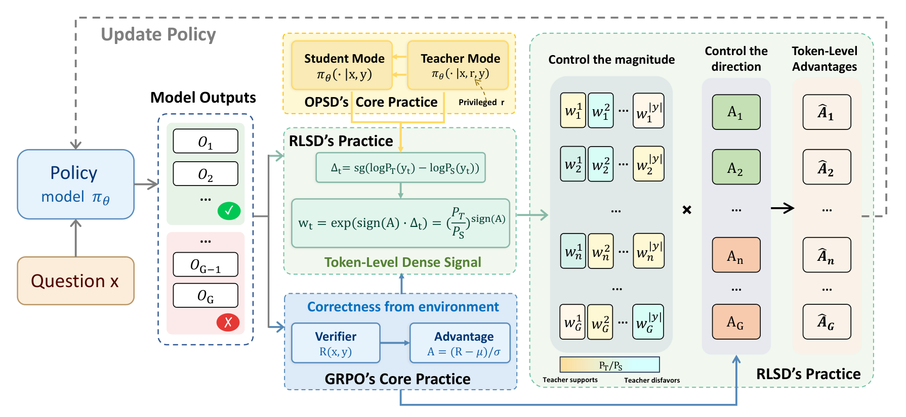
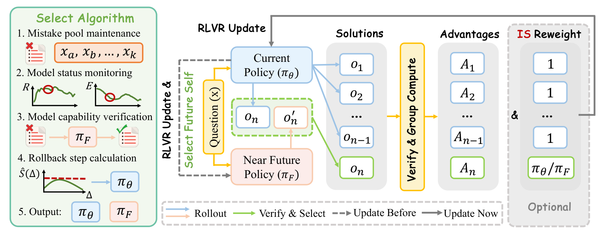
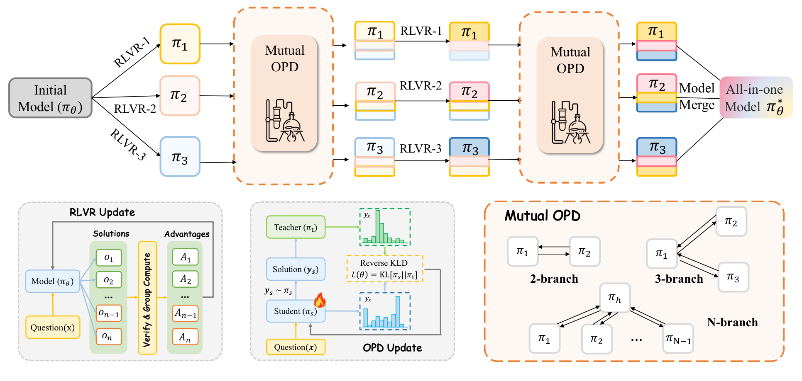

强化学习可验证奖励（Reinforcement Learning with Verifiable Rewards，RLVR）已经成为提升大模型推理能力的常用手段：它把“答案能否被规则或验证器判对”直接当作奖励，绕开了昂贵的人工偏好标注。但它有一个朴素的前提：模型必须先采样出可被验证器判对的轨迹，才能从奖励里学到东西。对难题而言，正确轨迹本就稀少，学习信号因此变得稀疏；若引入更强的外部教师做蒸馏，又要付出额外的模型、数据与工程成本。一个自然的追问是：教师能不能就是模型自己？

2026 年 4 月前后，认知智能生成课题组（G3 / CIGMA）的同学与老师联合京东研究者，连续公开了三篇工作：Self-Distilled RLVR（RLVR with Self-Distillation，RLSD）、Learning from the Near Future: Temporal Self-Distillation for RLVR（Near-Future Policy Optimization，NPO；这一蒸馏范式也称 Near-Future Policy Distillation，NPD）与 Co-Evolving Policy Distillation（CoPD）。三篇论文共享同一个叙事——**模型自己教自己（Self-Taught RLVR）**——但对“自己”的定义并不相同：RLSD 让看见参考答案的自己当教师，NPO 让短暂未来后的自己当教师，CoPD 让走另一条能力分支的自己当教师。本文按“问题 → 方法 → 结论”逐篇梳理三篇论文，再用一张表横向比较三条路径的教师信号来源、额外信息、代价与适用阶段。

需要说明作者归属：三篇论文中，凡署名单位为中国科学院信息工程研究所（IIE, CAS）或中国科学院大学网络空间安全学院（UCAS）的作者，均为本课题组的同学或老师；论文另有来自京东（JD.COM）的合作研究者。本文旨在解读、介绍课题组同学与老师的这组近期工作，也希望让更多读者由此了解课题组在强化学习、自我蒸馏与大模型后训练方向上的研究。

:::highlight[同一个问题，三种“自己”]
三篇论文都没有引入外部教师模型，而是从模型自身挖掘监督信号：RLSD 借助参考解答“看见答案的自己”，NPO 借助继续训练一小段后的 checkpoint“短暂未来后的自己”，CoPD 借助另一能力分支“走另一条路的自己”。差别不在是否自蒸馏，而在额外信息从哪来、以什么代价换取。
:::

## 一、RLSD：把“看见答案的自己”当作教师

本节解读 *Self-Distilled RLVR*（[arXiv:2604.03128v2](https://arxiv.org/abs/2604.03128)，2026-04-08 修订，arXiv 预印本）。作者为 Chenxu Yang、Chuanyu Qin、Qingyi Si、Minghui Chen、Naibin Gu、Dingyu Yao、Zheng Lin、Weiping Wang、Jiaqi Wang 与 Nan Duan；机构为中国科学院信息工程研究所（IIE, CAS）、中国科学院大学网络空间安全学院（UCAS）与京东（JD.COM），其中署名 IIE, CAS 或 UCAS 的作者均为本课题组成员。

**问题。** 在 RLVR 中，学生模型采样不到正确轨迹时，奖励信号无法转化为有效梯度。常见的补救是请一个更强的模型做 on-policy 蒸馏，但外部教师的能力上限、推理成本与部署复杂度都会成为新的瓶颈。RLSD 的观察是：如果题目存在参考解答，那么“已经看见解答的模型”与“还没看见解答的模型”之间，本身就有可利用的概率差。

**方法。** RLSD 把同一个模型放在两种条件下：教师分布 P_T 能看到参考解答 y*，学生分布 P_S 只能看到题目。对正确 token y_t，用 evidence ratio P_T(y_t) / P_S(y_t) 衡量参考解答对模型信念的修正倍数，可以近似理解为一次贝叶斯信念更新；取其对数 Δ_t 作为蒸馏信号。关键在于方向与幅度分离：方向由 verifier 对采样答案的接受信号 A 决定，幅度由 Δ_t 决定，于是 token 权重写成 w_t = exp(sign(A)·Δ_t) = (P_T/P_S)^{sign(A)}。教师只调整“信多少”，不决定“信什么”；实现上使用 stop-gradient，并对 ratio 做约 3%–6% 的裁剪，避免极端权重破坏训练稳定。

这一设计把“参考答案”从硬标签变成了软信号：模型不是被要求逐字复现解答，而是在自己已有的概率结构上，按参考解答修正那些真正影响正确性的 token。

**实验与结论。** 论文在 Qwen3-VL-8B-Instruct 上评测 5 个多模态推理基准。平均分从 Base 的 51.49 提升到 GRPO（Group Relative Policy Optimization，分组相对策略优化）的 53.86，OPSD（On-Policy Self-Distillation，同策略自我蒸馏）为 52.49，SDPO 为 52.74，GRPO+OPSD 为 52.91，RLSD 达到 56.18；相对 GRPO，MathVista 提升 1.9 分，MathVision 提升 3.91 分。作者给出的解释是：参考解答提供的不是外来的新知识，而是对模型内部已有知识的重新加权，因此既保留了 on-policy 采样的分布，又缓解了稀疏奖励下的学习困难。官方代码已在 GitHub 的 [iie-ycx/RLSD](https://github.com/iie-ycx/RLSD) 仓库公开。与另两篇工作相比，RLSD 的教师信号最直接，前提也最强——需要可信的参考解答；NPO 改从时间维度取“近未来”的 checkpoint，CoPD 改从能力分支取信号，二者绕开了参考答案，但分别付出分布漂移与双分支工程成本的代价。

[](https://arxiv.org/abs/2604.03128)

图源：*Self-Distilled RLVR*（[arXiv:2604.03128](https://arxiv.org/abs/2604.03128)，[CC BY 4.0](https://creativecommons.org/licenses/by/4.0/)）；图片未修改，仅按页面宽度缩放。

```bibtex
@misc{yang2026rlsd,
  title         = {{Self-Distilled RLVR}},
  author        = {Chenxu Yang and Chuanyu Qin and Qingyi Si and Minghui Chen and Naibin Gu and Dingyu Yao and Zheng Lin and Weiping Wang and Jiaqi Wang and Nan Duan},
  year          = {2026},
  eprint        = {2604.03128},
  archivePrefix = {arXiv},
  primaryClass  = {cs.LG},
  url           = {https://arxiv.org/abs/2604.03128}
}
```

## 二、NPO：把“短暂未来后的自己”当作教师

本节解读 *Learning from the Near Future: Temporal Self-Distillation for RLVR*（[arXiv:2604.20733v2](https://arxiv.org/abs/2604.20733)，2026-10-01 修订，arXiv 预印本；下文数字均以 v2 为准）。作者为 Chuanyu Qin、Chenxu Yang、Qingyi Si、Naibin Gu、Dingyu Yao、Zheng Lin、Peng Fu、Nan Duan 与 Jiaqi Wang；机构为中国科学院信息工程研究所（IIE, CAS）、中国科学院大学网络空间安全学院（UCAS）与京东（JD.COM），其中署名 IIE, CAS 或 UCAS 的作者均为本课题组成员。

**问题。** RLSD 依赖参考解答，而大量开放域任务并没有标准答案可供“看见”。另一条思路是让模型在训练中先走一小步，再把走完这一步的自己当作教师，回头指导当前的自己。这里立刻出现一个取舍：教师距离当前模型越远，能力越强，但分布漂移也越大；越近，分布越匹配，可提供的额外能力又越有限。

**方法。** NPO 把“近未来”定义为当前模型继续训练一小段时间后得到的 checkpoint，并用两个量刻画这段距离的价值：Q 表示未来教师带来的额外可验证能力，V 表示基于 KL 散度的 source–learner 不匹配代价，二者之比 S = Q / V 作为蒸馏距离的效率度量。实际训练中，论文用估计量 Ŝ(Δ) = Q̂(Δ) / V̂(Δ) 扫描不同的未来步长，取 Δ* = argmax Ŝ 作为教师距离；AutoNPO 则进一步把这一选择自动化。按 v2 摘要的区分，NPO 在验证过的未来轨迹上做 off-policy 行为迁移，NPD 则在学生自己生成的轨迹上做 token 级同策略蒸馏，二者共同构成本文的近未来自蒸馏框架。与固定使用最终模型或固定步长的做法相比，NPO 把“教师选多远”变成了一个可优化的资源分配问题。

**实验与结论。** 以 arXiv v2 为准，NPO 在 8 个图文基准上的平均分从 GRPO 的 60.25 提升到 NPO（early+late）的 62.84，AutoNPO 达到 63.15；文本 6 个基准从 48.7 提升到 52.5，视频 6 个基准从 58.30 提升到 59.44。进一步分析显示，让近未来教师继续做 RL 可达到 63.23，而更远未来的教师为 61.92；近未来教师来源的 verified success 从 53.1% 提升到 65.3%；单位代价带来的增益在近未来为 2.81，外部教师为 0.89，更远距离仅 0.11。这些数字指向同一个结论：**教师不是越强越好，而是越“合适”越好**。论文目前仍为预印本，未发现官方代码仓库，Hugging Face 论文页为 [2604.20733](https://huggingface.co/papers/2604.20733)。与 CoPD 相比，NPO 只在同一条能力分支上沿时间轴选择教师，不必维护多分支；CoPD 则从另一条能力分支取异构信号，代价是双分支训练与双向蒸馏的工程成本。

:::highlight[为什么“近未来”反而更好]
近未来教师与当前模型的分布最接近，KL 代价 V 小；同时它已经多走了一小段训练，能提供当前模型尚未获得的额外能力 Q。距离再拉远，Q 的边际增长赶不上 V 的上升，单位代价的增益从 2.81 迅速跌到 0.11。NPO 的核心不是“找更强的自己”，而是“找性价比最高的自己”。
:::

[](https://arxiv.org/abs/2604.20733)

图源：*Learning from the Near Future: Temporal Self-Distillation for RLVR*（[arXiv:2604.20733v2](https://arxiv.org/abs/2604.20733)，[CC BY 4.0](https://creativecommons.org/licenses/by/4.0/)）；图片未修改，仅按页面宽度缩放。

```bibtex
@misc{qin2026npo,
  title         = {{Learning from the Near Future: Temporal Self-Distillation for RLVR}},
  author        = {Chuanyu Qin and Chenxu Yang and Qingyi Si and Naibin Gu and Dingyu Yao and Zheng Lin and Peng Fu and Nan Duan and Jiaqi Wang},
  year          = {2026},
  eprint        = {2604.20733},
  archivePrefix = {arXiv},
  primaryClass  = {cs.LG},
  url           = {https://arxiv.org/abs/2604.20733}
}
```

## 三、CoPD：把“走另一条路的自己”当作教师

本节解读 *Co-Evolving Policy Distillation*（[arXiv:2604.27083v1](https://arxiv.org/abs/2604.27083)，2026-04-29，arXiv 预印本）。作者为 Naibin Gu、Chenxu Yang、Qingyi Si、Chuanyu Qin、Dingyu Yao、Peng Fu、Zheng Lin、Weiping Wang、Nan Duan 与 Jiaqi Wang；机构为中国科学院信息工程研究所（IIE, CAS）、中国科学院大学网络空间安全学院（UCAS）与京东（JD.COM），其中署名 IIE, CAS 或 UCAS 的作者均为本课题组成员。

**问题。** 前两条路径都从同一个能力分支里取教师：RLSD 取同一模型看见答案后的分布，NPO 取同一模型未来时刻的分布。但如果模型只有一条能力路径，自我蒸馏很容易在同质信号上打转：学生能学到的，终究跳不出这条路径已经走过的范围。静态的同策略蒸馏（On-Policy Distillation，OPD）尤其如此，教师与学生在同一分布上互相靠近，能力转化率低。

**方法。** CoPD 的做法是同时维护两条能力分支——文本分支与多模态分支——分别做 RLVR，再让两条分支通过双向 mutual OPD 互相蒸馏。作者用 U_P ≈ a_P · X(D1,D2) + b_P 描述一次蒸馏带来的能力变化，其中下标 P 表示 policy（策略），X(D1,D2) 是两条分支之间的可迁移能力，a_P ∈ [0,1] 是能力转化率，b_P ≤ 0 表示蒸馏可能带来的额外损失；混合 RLVR 的收益则写成 U_mix ≈ X − Φ(D1,D2)，Φ 表示混合训练引入的干扰成本。静态 OPD 的转化率 a_static = η(O_low) 很小，且 b_static = 0；CoPD 通过“分支内 RLVR + 分支间双向 OPD”，让模型处在更丰富的 O_mod 上，从而获得 η(O_mod) ≫ η(O_low) 的转化效率。直观地说，每条分支都在教另一条分支“我不会、但你会”的那部分能力。

**实验与结论。** 在 Qwen3-VL 的 4B 规模上，CoPD 的汇总平均分为 57.71；去掉 I-OPD 为 57.04，去掉 T-OPD 为 57.02，只用文本分支为 57.24。单项上，MathVista 达到 76.80（Mixed RLVR 75.55、MOPD 74.75），MathVision 达到 57.57（Mixed RLVR 56.00、MOPD 56.99）。这组消融说明，双向蒸馏的两个方向都不可省略，异构分支之间的互补性正是收益来源。论文同样按 arXiv 预印本呈现，未发现官方代码仓库，Hugging Face 论文页为 [2604.27083](https://huggingface.co/papers/2604.27083)。

[](https://arxiv.org/abs/2604.27083)

图源：*Co-Evolving Policy Distillation*（[arXiv:2604.27083v1](https://arxiv.org/abs/2604.27083)，[CC BY 4.0](https://creativecommons.org/licenses/by/4.0/)）；图片未修改，仅按页面宽度缩放。

```bibtex
@misc{gu2026copd,
  title         = {{Co-Evolving Policy Distillation}},
  author        = {Naibin Gu and Chenxu Yang and Qingyi Si and Chuanyu Qin and Dingyu Yao and Peng Fu and Zheng Lin and Weiping Wang and Nan Duan and Jiaqi Wang},
  year          = {2026},
  eprint        = {2604.27083},
  archivePrefix = {arXiv},
  primaryClass  = {cs.LG},
  url           = {https://arxiv.org/abs/2604.27083}
}
```

## 四、横向对比：三种“自己”的代价

把三篇论文放在一起看，分歧首先体现在教师信号的来源上，其次体现在额外信息、核心代价与适用阶段上。下表按四个维度整理；表格在窄屏下只在自身容器内横向滚动，不改变页面宽度。

:::table[表 1：三篇工作的定位对比]
| 维度 | RLSD | NPO | CoPD |
| --- | --- | --- | --- |
| 教师信号来源 | 看见答案的自己：同一模型在参考解答条件下的分布 | 短暂未来后的自己：继续训练一小段后的 checkpoint | 走另一条路的自己：另一能力分支的模型 |
| 是否引入额外信息 | 参考解答 y* | 未来 checkpoint 带来的可验证能力 | 另一分支的可迁移能力 |
| 核心代价与风险 | 参考解答的质量与信息泄漏；ratio 需裁剪 | 教师距离取舍；KL 不匹配随距离上升 | 分支间漂移；双分支训练与互相蒸馏的工程成本 |
| 适用阶段 | 训练期间，且有可信参考答案 | 训练期间或之后，可自举、无需参考答案 | 训练期间，存在多能力分支或多模态异构分支 |
| 代表性结果 | 多模态 5 基准平均 56.18 | 图文 8 基准 AutoNPO 平均 63.15 | 4B 汇总平均 57.71 |

:::

三者并不是互斥方案，而是同一目标下的三种资源调度：RLSD 用“答案”换监督密度，NPO 用“时间”换监督密度，CoPD 用“分支”换监督密度。它们的共同前提是模型已经具备可被激发的潜在能力；自我蒸馏做的是把这份能力从一种条件、一个时刻或一条路径，迁移到另一种条件、当前时刻或另一条路径。

:::highlight[一句话总结三条路径]
RLSD 回答“有答案时怎么教”，NPO 回答“没答案时教多远”，CoPD 回答“只有一条路时向谁学”。把这三问放在一起，Self-Taught RLVR 的轮廓就清楚了：教师来自模型自身的不同侧面，关键是选对侧面并控制代价。
:::

## 五、对后续研究与工程实践的启示

第一，**教师信号的来源可以设计，而不必外购**。三篇工作分别把答案条件、时间推进与能力分支转化为教师，说明自我蒸馏的空间比“用大模型教小模型”更宽。对资源有限的团队，这提供了一条不依赖闭源教师的能力提升路径。

第二，**代价必须与收益一起度量**。NPO 的 gain-per-cost 与 CoPD 的能力转化率都表明，自蒸馏不是免费的：分布漂移、KL 代价、分支干扰都会侵蚀收益。工程上应把教师距离、裁剪范围、分支权重当作需要调优的资源参数，而不是固定的超参数。

第三，**评测要覆盖迁移后的分布**。RLSD 在多模态推理上验证，NPO 同时覆盖图文、文本与视频，CoPD 比较文本与多模态分支，三者都强调在目标分布上评估，而不是只看训练集奖励。这一点对复现尤为重要。

需要说明的是，三篇论文均以 arXiv 预印本形式公开，本文的数字与结论以对应版本为准，其中 NPO 采用 v2；正式发表信息发布前，本文不据此推断任何会议接收状态。文中公式与指标均取自论文公开页面，未做外推。三张主图来自论文公开页面，按 CC BY 4.0 使用，仅按页面宽度缩放，未做其他修改。

自我蒸馏的研究仍在快速推进。可以预见的问题包括：当模型自身能力不足时，近未来教师是否会一起“卡住”；当分支数量增加时，互相蒸馏的成本如何增长；以及如何在训练早期判断一条自蒸馏路径是否值得继续。课题组这三篇论文给出了三种可操作的起点，但离统一的答案还有距离。

本文旨在解读、介绍课题组同学与老师的这组近期工作，也希望借此让更多读者了解课题组在强化学习、自我蒸馏与大模型后训练方向上的研究。若对相关方向感兴趣，欢迎通过主页“Join Us”了解课题组的招生与实习信息。
